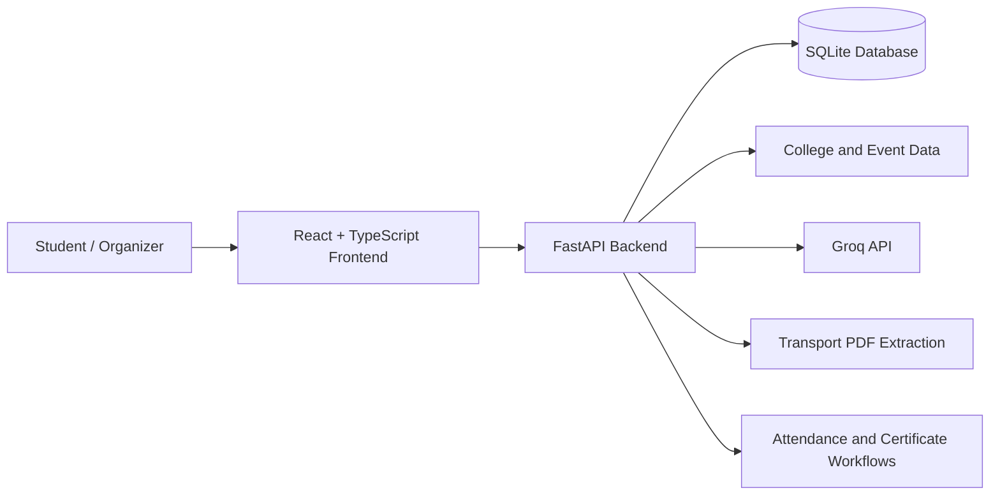

# EveHub — Unified Inter-College Event Discovery & Verified Participation Platform

EveHub is a modern, trusted web platform engineered to eliminate chaotic Google Forms, unverified social media posters, and scheduling clashes across collegiate symposiums, hackathons, workshops, and sports tournaments.

---

## Key Capabilities Across Phases

### 1. Deterministic Timetable Conflict Guard (Phase 3)
- Rather than relying on inaccurate AI guesses, EveHub implements exact mathematical interval overlap logic:
  $$\max(S_1, S_2) < \min(E_1, E_2)$$
- Checks academic exams, mandatory labs, and lecture commitments against collegiate event intervals.
- Evaluates boundaries cleanly: exact end-to-start boundaries are non-conflicting.
- Provides informative alerts before registration and allows informed student acknowledgment.

### 2. Zero-Trust Venue Check-In & Attendance (Phase 4)
- Prevents student self-reporting of attendance.
- Generates unique cryptographic QR tokens (`EVH-CHK-XXXX`) upon confirmed registration.
- On-venue organizer scanning console with duplicate check-in prevention and audit logging.

### 3. Verifiable Digital Credentials (Phase 4 & 5)
- Certificates of Participation, Excellence, and Category Winners are minted strictly after verified gate check-in.
- Generates high-resolution vector PDF certificates directly in the browser via `jsPDF`.
- Public validator at `/verify-certificate/:certId` confirms validity without exposing sensitive student personal data.

### 4. FIFO Priority Waitlist & Seat Recovery (Phase 4)
- Enforces hard seat capacities.
- Strict timestamped First-In-First-Out queue order.
- When an attendee cancels a pass, the seat is automatically returned to the pool and offered to the next waitlisted student with a 24-hour acceptance window.

### 5. Campus Logistics & WhatsApp Communities (Phase 3)
- Official college shuttle transport details: designated pickup spots, morning departure and evening return times, bus coordinator contacts.
- Event-specific WhatsApp community invite links revealed upon verified registration.

---

## Architecture & Technology Stack

| Layer | Technologies |
|---|---|
| Frontend | React, TypeScript, Vite |
| UI and styling | Tailwind CSS |
| Backend API | Python, FastAPI, Pydantic |
| Database | SQLite for the current backend; Supabase/PostgreSQL schema available in the repository |
| Interactive maps | Leaflet, OpenStreetMap |
| Geospatial calculations | Haversine distance calculation |
| AI transport assistant | Groq API, with a document-extraction fallback |
| PDF processing | pypdf |
| Authentication | JWT and bcrypt-based password hashing |
| QR and attendance | QR-based check-in workflows |
| Deployment configuration | Vercel and Render configuration files |

---

## 🏗️ Architecture at a Glance



The frontend communicates with the backend through API endpoints. The backend handles event and college queries, registration-related operations, schedule checks and transport-assistant requests.

Groq credentials belong on the backend and should never be exposed in client-side code.

---

## 🚀 Running EveHub Locally

### Prerequisites

- Python 3.10 or newer, compatible with the project's dependencies
- Node.js 18 or newer
- npm

### 1. Clone the repository

```bash
git clone https://github.com/gokulakannanpm/NewStars_Boopathi.git
cd NewStars_Boopathi
```

### 2. Start the backend

```bash
cd backend
pip install -r requirements.txt
python -m uvicorn main:app --reload --host 127.0.0.1 --port 8000
```

Backend API: `http://127.0.0.1:8000`

Interactive API documentation: `http://127.0.0.1:8000/docs`

### 3. Start the frontend

Open another terminal:

```bash
cd frontend
npm install
npm run dev
```

Open the local URL printed by Vite in your terminal.

### 4. Configure the optional Groq integration

For the AI transport assistant, configure `GROQ_API_KEY` in the backend environment. Keep secrets out of Git and frontend environment variables.

Without a working Groq configuration, the existing deterministic transport-information fallback can respond when relevant schedule data is available.

---

## 🔐 Responsible Data and Limitations

EveHub is being developed as a hackathon prototype. Some integrations and deployment concerns still require further work.

- **Campus data:** Map coverage depends on the accuracy and completeness of the available campus records and coordinates.
- **Event status:** Live status should be derived from event timestamps and reliable event data, not assumed from a published listing.
- **AI answers:** Transport responses depend on the contents and readability of uploaded PDFs. The assistant should not invent missing routes or times.
- **Notifications:** Real email and WhatsApp delivery depends on provider configuration and implementation; a displayed notification should not be treated as proof of external delivery.
- **Payments:** The current scope uses a demo/simulated payment experience. No real payment gateway is required for this prototype.
- **Storage and deployment:** Local SQLite and filesystem uploads are convenient for development. Production deployment requires appropriate persistent storage, environment configuration and access controls.

We intend to improve coverage, reliability, accessibility and production readiness as the project evolves.

---

## Pre-Configured Demo Accounts

For evaluation without typing credentials, click **"Student View"** or **"Organizer View"** in the top black notification bar on any page:

1. **Student Account:**
   - **Name:** Gokul Kannan
   - **Institution:** SSN College of Engineering (Dept of IT, 3rd Year)
   - **Pre-seeded conflicts:** Continuous Assessment Exam on Shaastra Hackathon day
   - **Credentials:** `student@evehub.in` / `evehub123`

2. **Organizer Account:**
   - **Name:** Dr. Arun Kumar (Convener)
   - **Institution:** College of Engineering, Guindy (Anna University)
   - **Authority:** Host check-in gate operator, certificate minting authority
   - **Credentials:** `organizer@evehub.in` / `evehub123`
