# 🌐 EveHub — Discover What's Happening Around You

<p align="center">
  <strong>One campus. One city. Countless opportunities.</strong>
  <br />
  Discover nearby hackathons, symposiums, workshops, conferences and student communities — all in one place.
  <br /><br />
  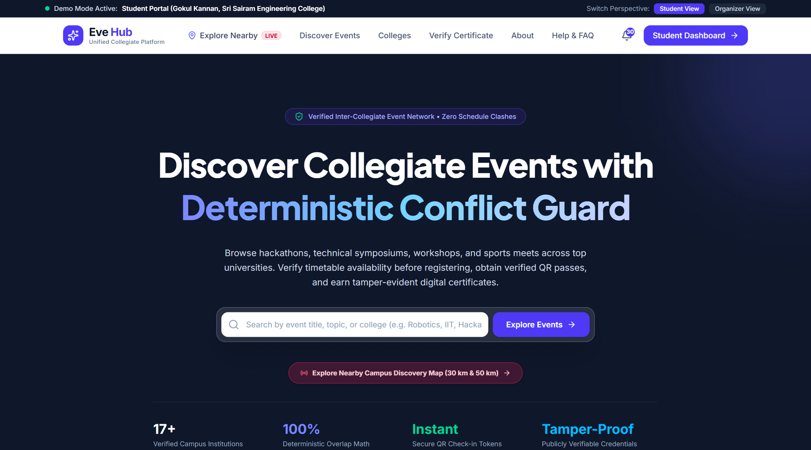
</p>

<p align="center">
  
  
  
</p>

---

## 🚨 The Problem: Opportunities Are Everywhere. Discovering Them Isn't.

Every day, colleges, startups and student communities organize hackathons, technical symposiums, workshops, conferences and competitions.

Yet discovering the right event remains unnecessarily difficult.

Event information is scattered across WhatsApp groups, Instagram posts, LinkedIn, posters, Google Forms and individual college websites. Students often discover opportunities too late, miss events happening at nearby colleges, or struggle to determine whether an event is worth attending.

At the same time, organizers struggle to reach the students who are most likely to participate.

**The result? Missed opportunities, fragmented communication and lower community participation.**

### The gap we want to solve

| For students | For organizers |
|---|---|
| Relevant events are scattered across multiple platforms. | Reaching the right audience is difficult. |
| Nearby college events are hard to discover. | Event visibility is fragmented. |
| Timetable and exam conflicts complicate decisions. | Repeated questions consume organizers' time. |
| Registration, travel and event information live in different places. | Managing registrations, attendance and certificates takes effort. |

> **Our central question:** What if students could open one platform, explore nearby colleges on a map, and immediately discover the opportunities happening around them?

---

## 💡 Introducing EveHub

**EveHub is a hyperlocal event discovery and campus engagement platform that connects students with opportunities across nearby colleges.**

Instead of making students search through dozens of disconnected sources, EveHub brings campus discovery, event information and participation workflows into one experience.

Its defining feature is an **interactive nearby-college map**. Students can explore colleges within a selected radius, select a campus, and inspect its available events — creating a location-first way to discover opportunities beyond their own institution.

EveHub also supports the journey beyond discovery: from checking schedule conflicts and registering for events to verified attendance and digital certificates.

<p align="center">
  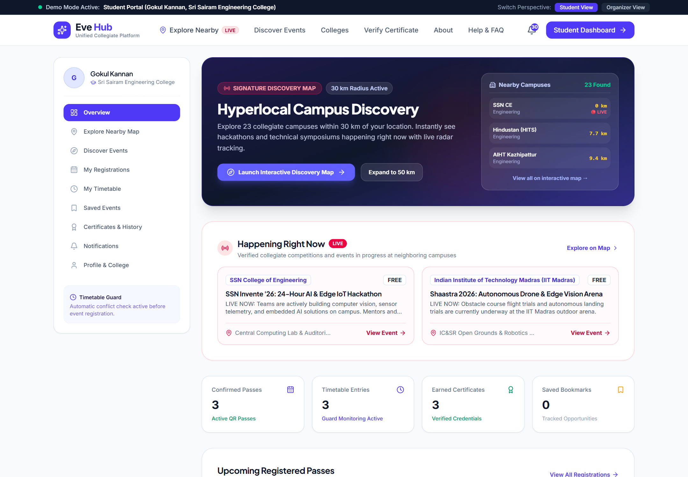
  <br />
  <em>Interactive student command center: Personalized live event radar, registered symposiums, and institutional profile at Sri Sairam Engineering College.</em>
</p>

---

## 🗺️ 1. Explore Nearby Colleges — Our Core Differentiator

**Don't just search for events. Discover the campuses around you.**

Traditional event listings primarily ask students to search for an event by name or category. EveHub makes the surrounding campus ecosystem the starting point.

### How it works

1. **Choose your location:** Use the available location-detection flow or manually select a city or search location.
2. **Set your radius:** Explore within 30 km or 50 km.
3. **Discover campuses:** View matching colleges on an interactive map and in a nearby-college list.
4. **Select a college:** Inspect its event listings and identify opportunities relevant to you.
5. **Open an event:** View its details and continue through the event's registration flow.

The map is designed to support college-type filtering, including engineering institutions, so students can discover opportunities across campus boundaries.

### What makes this important?

- **Location-first discovery:** Find opportunities based on where you are or where you want to explore.
- **Cross-campus visibility:** Discover events hosted beyond your own college.
- **Campus-level browsing:** Move from a college on the map to its associated events.
- **Time-aware discovery:** Distinguish ongoing events from upcoming ones using event schedules.
- **A scalable foundation:** The same discovery experience can extend to more institutions and regions as the campus dataset grows.

<p align="center">
  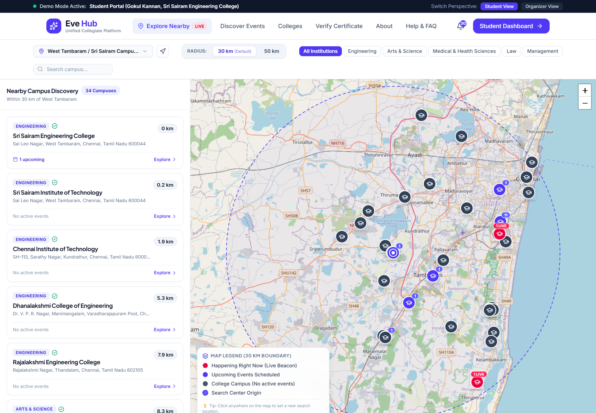
  <br />
  <em>EveHub Explore Nearby Map: Interactive Leaflet viewport centered at Sri Sairam Engineering College (West Tambaram) with a 30 km dynamic radius filter discovering 34 matching campuses.</em>
</p>

<p align="center">
  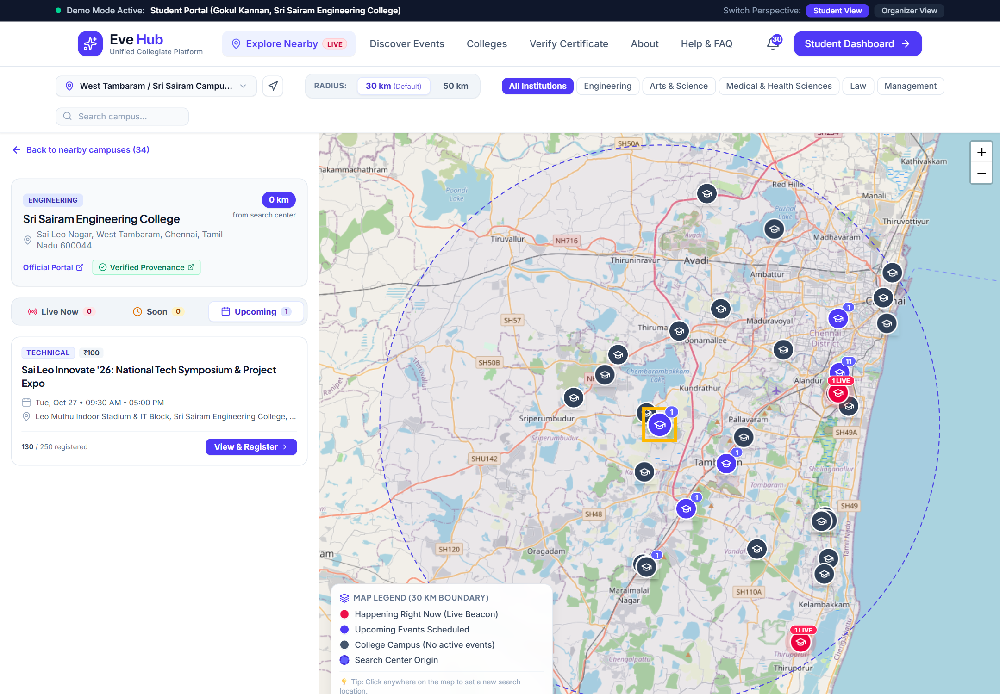
  <br />
  <em>Campus-level discovery panel: Selecting Sri Sairam Engineering College reveals its verified provenance link, campus address, exact distance (0.0 km), and upcoming symposium "Sai Leo Innovate '26".</em>
</p>

**Our vision:** A student should not have to know which college is hosting an event before discovering that the opportunity exists.

*Data transparency matters: campus presence does not imply that an event is currently running. Live-event labels must be based on event schedules, and demo records should be distinguishable from verified event information.*

---

## ✨ 2. More Than Event Discovery

EveHub aims to connect the entire student participation journey.

### 📅 Smart Schedule and Exam-Conflict Checks

Students can maintain their academic timetable and check for overlaps before committing to an event.

The conflict engine compares event time intervals with recorded academic commitments, helping students make more informed participation decisions.

<p align="center">
  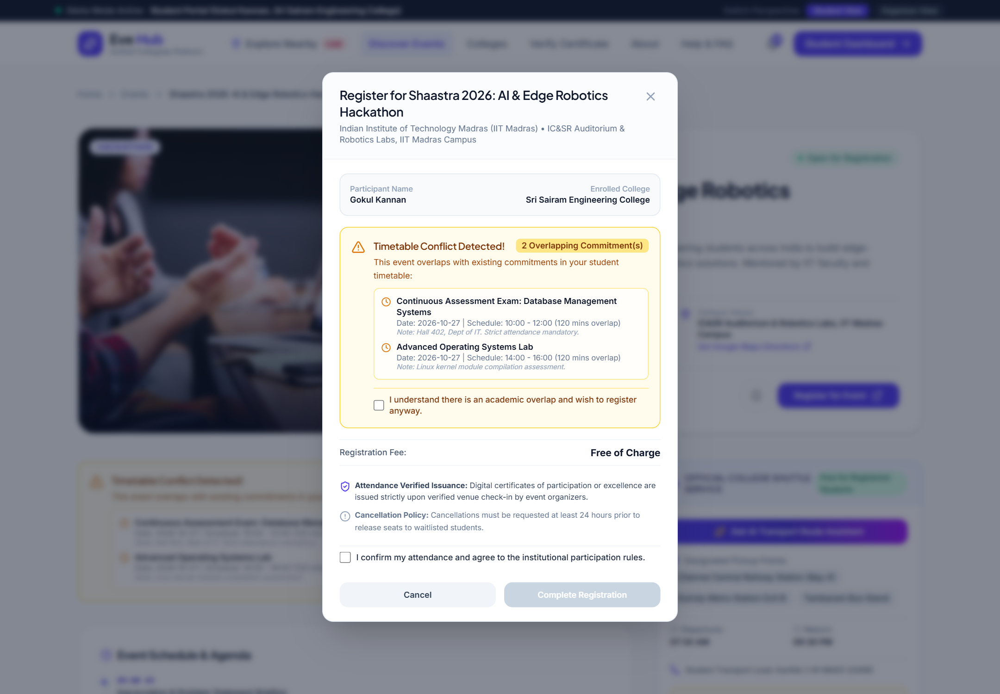
  <br />
  <em>Deterministic interval conflict guard: Proactively detects schedule overlap between the Shaastra AI Hackathon and academic commitments (Database Systems exam), preventing double-booking.</em>
</p>

### 🎟️ Event Discovery and Registration

Explore events, inspect event details, review available registration information and follow the appropriate registration flow.

Discovery and registration are connected, so students can move from finding an opportunity to acting on it.

<p align="center">
  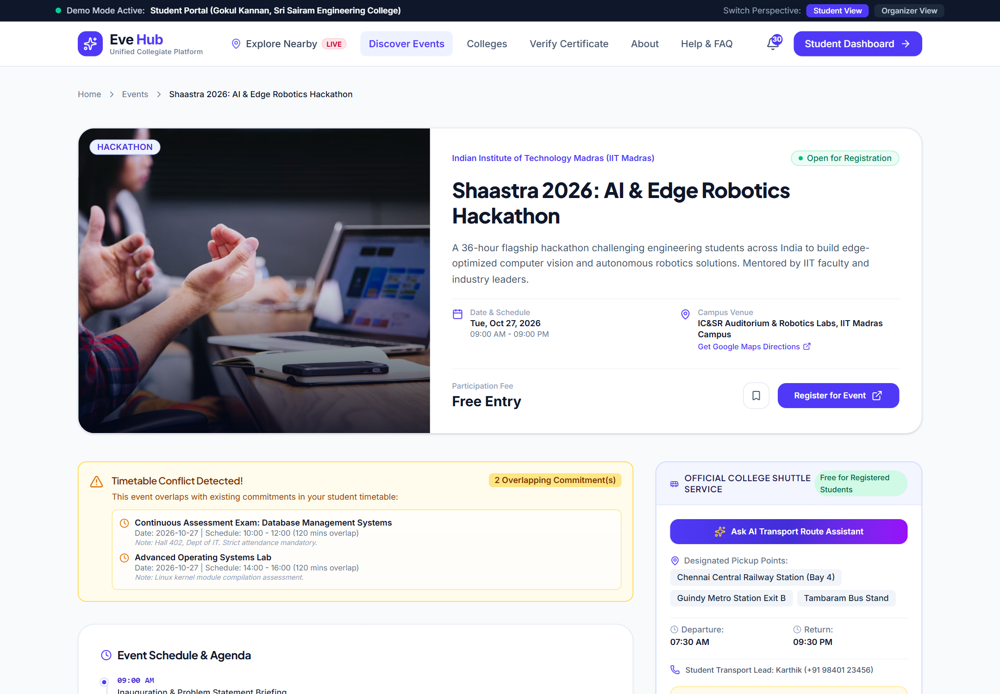
  <br />
  <em>Event discovery & registration interface: Comprehensive agenda, live capacity counter, logistics summary, shuttle schedule card, and integrated ticket tier selection for IIT Madras Shaastra 2026.</em>
</p>

### 🚌 AI-Assisted Campus Transport Information

Organizers can upload an event's transport schedule as a PDF. Students can ask natural-language questions about pickup points, routes and departure times.

The transport assistant extracts information from the available document and can use Groq-powered language-model responses when the backend is configured with an API key. A keyword-based fallback is also available.

The goal is to make event logistics easier to understand without forcing students to manually search lengthy schedules.

<p align="center">
  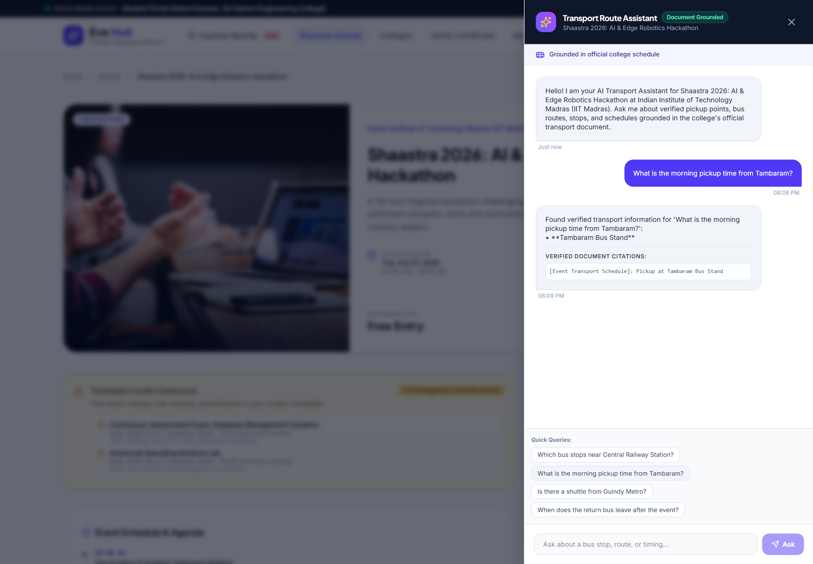
  <br />
  <em>AI transport assistant: Grounded document retrieval over official collegiate shuttle circulars, answering student route queries with precise source citations.</em>
</p>

### 📷 QR-Based Attendance and Team Check-In

EveHub supports QR-based attendee check-in, manual fallback and team check-in workflows. These features help organizers record attendance and support downstream participation verification.

<p align="center">
  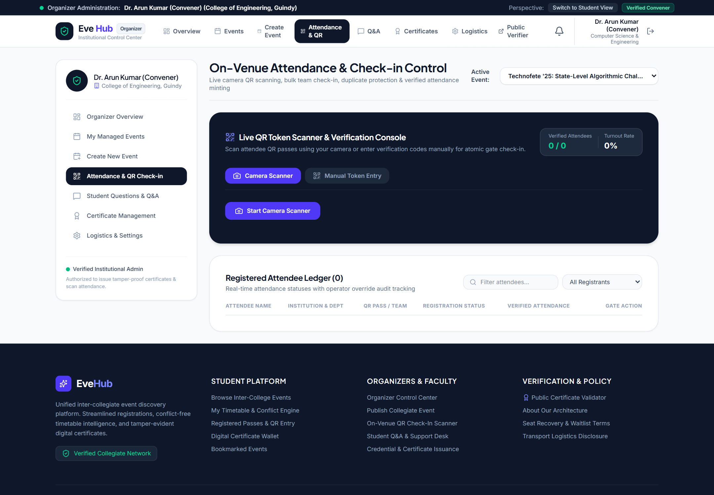
  <br />
  <em>On-venue check-in control: Live camera QR code scanner with cryptographic token verification, real-time participant roster, and manual fallbacks.</em>
</p>

### 🏅 Digital Certificates and Verification

EveHub supports certificate templates, bulk certificate issuance, student certificate access and public verification workflows.

The aim is to make participation credentials easier to issue, retrieve and verify after an event.

<p align="center">
  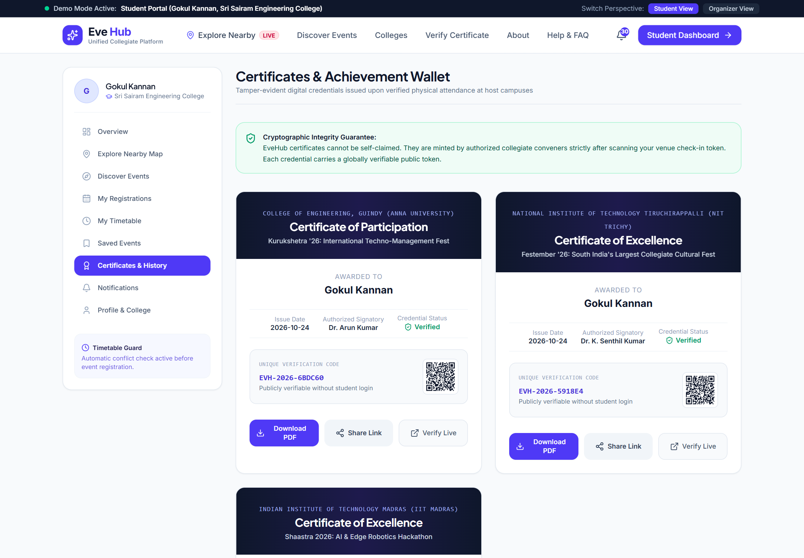
  <br />
  <em>Digital achievement wallet: Cryptographically verifiable credentials for attended events with unique verification hashes and instant download capabilities.</em>
</p>

### 💬 Organizer–Student Communication

EveHub includes event-related student questions and organizer responses, providing a foundation for more organized event communication.

The broader vision is to reduce repeated questions by allowing organizers to share useful answers with relevant participants.

### ⏳ Waitlists and Seat Management

EveHub supports registration-capacity handling and waitlist-related workflows, helping organizers manage demand when an event reaches its capacity.

### 📊 Organizer Event Command Center

Organizers manage the complete lifecycle of their events through a unified command center. From monitoring live registration volume and capacity thresholds to initiating on-venue QR scanning consoles and managing attendee status, EveHub equips hosts with full operational control.

<p align="center">
  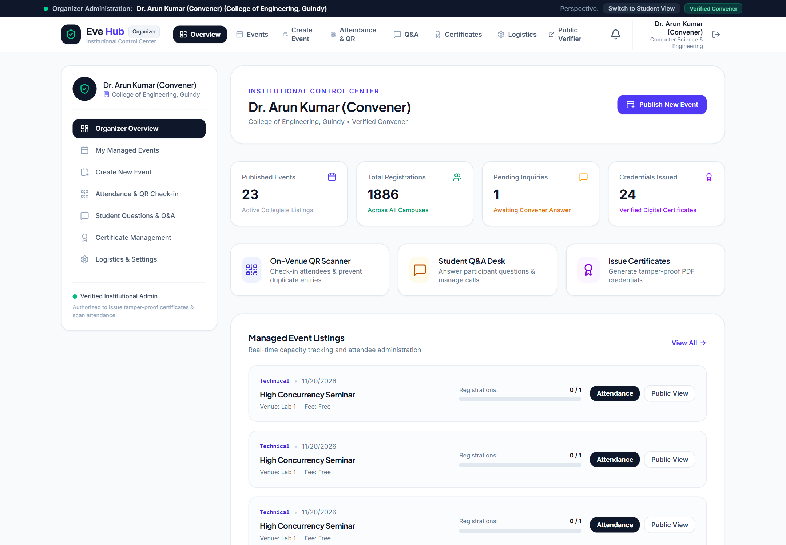
  <br />
  <em>Organizer operations cockpit: Real-time visibility into registrations, attendee rosters, check-in percentages, and multi-tier ticketing controls.</em>
</p>

---

## 🔄 How EveHub Works

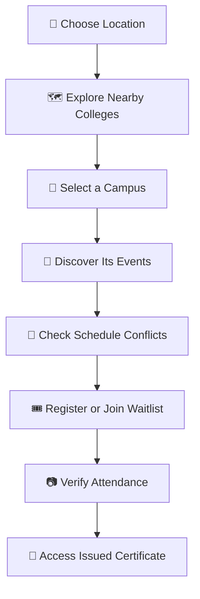

*This illustrates the intended student journey; individual steps depend on the event configuration and the availability of the relevant feature.*

---

## 🆚 What Makes EveHub Different?

EveHub is not simply another list of events.

| Capability | Typical event listing | EveHub's approach |
|---|---|---|
| Event discovery | Search or browse event listings | Start with nearby colleges on a map |
| Geographic exploration | Often secondary to event listings | Select a location and radius |
| Campus-level discovery | Depends on available filters | Select a campus to inspect its events |
| Schedule awareness | May be separate from discovery | Integrate timetable-conflict checks |
| Transport information | Often shared as a document | Ask questions about an uploaded route PDF |
| Participation workflow | Varies by platform | Connect registration, attendance and certificates |

EveHub's central differentiator is **location-first, campus-level event discovery combined with participation workflows**.

We are not claiming that every individual feature is unique in isolation. Our focus is bringing them together around a student's local campus ecosystem.

---

## 🛠️ Technology Stack

| Layer | Technologies |
|---|---|
| Frontend | React, TypeScript, Vite |
| UI and styling | Tailwind CSS |
| Backend API | Python, FastAPI, Pydantic |
| Database | SQLite for the current backend; Supabase/PostgreSQL schema available in the repository |
| Interactive maps | Leaflet, OpenStreetMap |
| Geospatial calculations | Haversine distance calculation |
| AI transport assistant | Groq API, with a document-extraction fallback |
| PDF processing | pypdf |
| Authentication | JWT and bcrypt-based password hashing |
| QR and attendance | QR-based check-in workflows |
| Deployment configuration | Vercel and Render configuration files |

---

## 🏗️ Architecture at a Glance

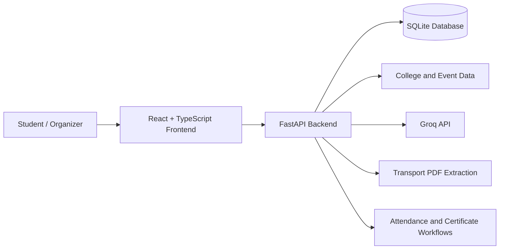

The frontend communicates with the backend through API endpoints. The backend handles event and college queries, registration-related operations, schedule checks and transport-assistant requests.

Groq credentials belong on the backend and should never be exposed in client-side code.

---

## 🚀 Running EveHub Locally

### Prerequisites

- Python 3.10 or newer, compatible with the project's dependencies
- Node.js 18 or newer
- npm

### 1. Clone the repository

```bash
git clone https://github.com/gokulakannanpm/NewStars_Boopathi.git
cd NewStars_Boopathi
```

### 2. Start the backend

```bash
cd backend
pip install -r requirements.txt
python -m uvicorn main:app --reload --host 127.0.0.1 --port 8000
```

Backend API: `http://127.0.0.1:8000`

Interactive API documentation: `http://127.0.0.1:8000/docs`

### 3. Start the frontend

Open another terminal:

```bash
cd frontend
npm install
npm run dev
```

Open the local URL printed by Vite in your terminal.

### 4. Configure the optional Groq integration

For the AI transport assistant, configure `GROQ_API_KEY` in the backend environment. Keep secrets out of Git and frontend environment variables.

Without a working Groq configuration, the existing deterministic transport-information fallback can respond when relevant schedule data is available.

---

## 🔐 Responsible Data and Limitations

EveHub is being developed as a hackathon prototype. Some integrations and deployment concerns still require further work.

- **Campus data:** Map coverage depends on the accuracy and completeness of the available campus records and coordinates.
- **Event status:** Live status should be derived from event timestamps and reliable event data, not assumed from a published listing.
- **AI answers:** Transport responses depend on the contents and readability of uploaded PDFs. The assistant should not invent missing routes or times.
- **Notifications:** Real email and WhatsApp delivery depends on provider configuration and implementation; a displayed notification should not be treated as proof of external delivery.
- **Payments:** The current scope uses a demo/simulated payment experience. No real payment gateway is required for this prototype.
- **Storage and deployment:** Local SQLite and filesystem uploads are convenient for development. Production deployment requires appropriate persistent storage, environment configuration and access controls.

We intend to improve coverage, reliability, accessibility and production readiness as the project evolves.

---

## 🔭 What's Next?

Our roadmap focuses on making hyperlocal discovery increasingly useful:

- Expand and verify college and campus coverage.
- Improve the accuracy and freshness of event listings.
- Refine the map's location search and campus-level exploration.
- Strengthen student reminders and event communication.
- Improve mobile usability and accessibility.
- Continue hardening backend security, persistent storage and deployment reliability.

The long-term vision is an ecosystem where students can discover opportunities beyond their own campus and organizers can reach relevant nearby communities more effectively.

---

## 🎥 Project Demonstration

**Two-minute demo video:** [ADD YOUR VIDEO LINK HERE]

**Live application:** [ADD YOUR DEPLOYED APPLICATION LINK HERE]

**GitHub repository:** [NewStars_Boopathi](https://github.com/gokulakannanpm/NewStars_Boopathi)

Suggested demo sequence:

1. Open the student dashboard.
2. Show the Explore Nearby map and radius selector.
3. Select a college and open its event list.
4. Open an event and demonstrate the timetable-conflict check or registration flow.
5. Show the transport assistant or certificate workflow.

Prioritize the map in the opening seconds: it is the fastest way to communicate EveHub's core idea.

---

## 🏆 Built for VECNAVERSE — National Level Hackathon

**Problem Statement:** Hyperlocal Event Discovery & Community Engagement

**Domain:** Software Development

EveHub was developed in response to the challenge of helping people discover relevant nearby events, improving event visibility for organizers and encouraging meaningful community participation.

We sincerely thank the **VECNAVERSE National Level Hackathon organizers** for providing this problem statement and the opportunity to build, experiment and present a solution.

We also thank the mentors, evaluators and everyone involved in creating an environment where students can turn ideas into working prototypes.

**EveHub — Bringing nearby opportunities closer to every student.**

---

<p align="center">
  <strong>Built with ❤️ for students, campuses and communities.</strong>
</p>